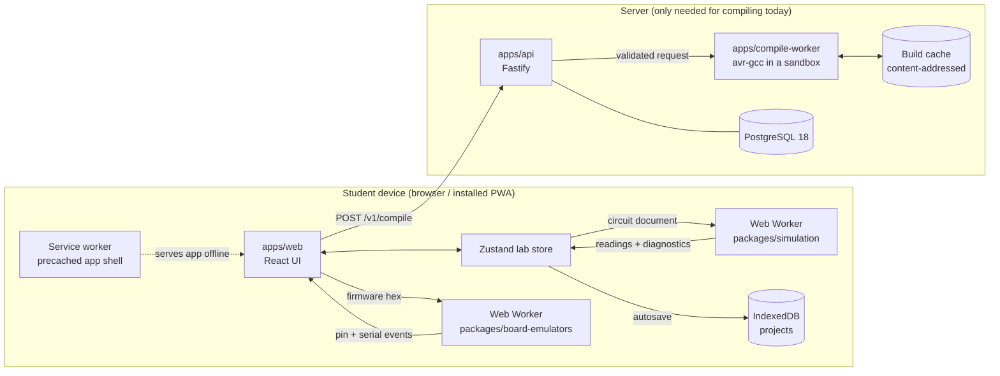
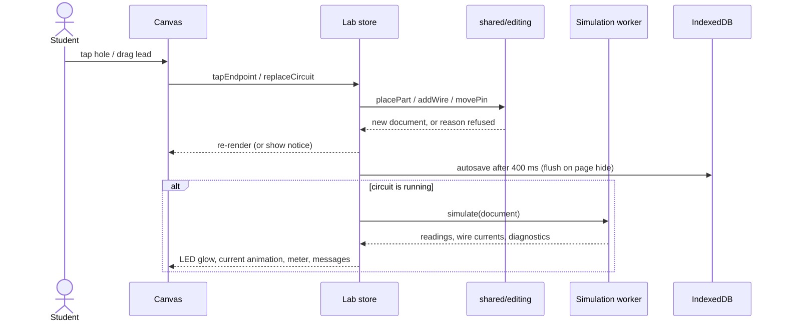
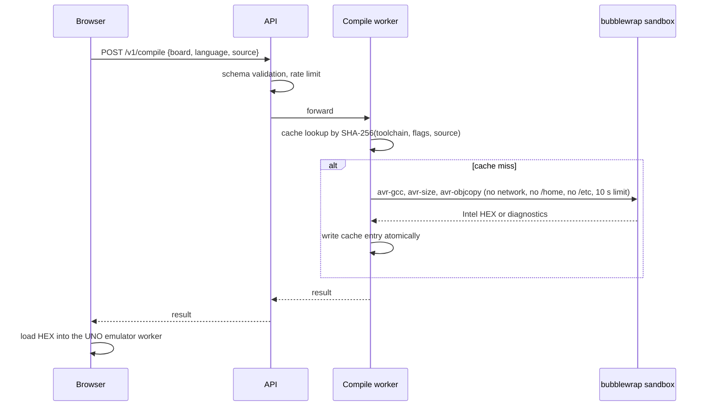

# Architecture overview

## Components

## Layering rules

| Layer        | Package               | May depend on              | Must not know about                        |
| ------------ | --------------------- | -------------------------- | ------------------------------------------ |
| Numerics     | `circuit-engine`      | nothing                    | breadboards, parts, UI                     |
| Domain model | `shared`              | typebox                    | simulation, UI, server                     |
| Simulation   | `simulation`          | `circuit-engine`, `shared` | UI, storage, network                       |
| Emulation    | `board-emulators`     | avr8js                     | UI, circuits (until Phase 1 co-simulation) |
| Text         | `i18n`                | nothing                    | UI framework                               |
| UI           | `apps/web`            | all packages               | database                                   |
| API          | `apps/api`            | —                          | simulation internals                       |
| Compiler     | `apps/compile-worker` | —                          | database, secrets                          |

ESLint enforces the first rows: nothing under `packages/` may import React,
Fastify, Drizzle or Dexie. Packages are consumed as TypeScript source (no
per-package build step), which keeps the edit–run loop instant.

## Data flow: editing and running a circuit

The document is immutable: every edit returns a new document or an error code,
so the editor can never hold an invalid circuit and every rule is unit-tested
without a browser.

## Data flow: compile and run

## Offline behaviour

| Works offline                           | Needs the server                         |
| --------------------------------------- | ---------------------------------------- |
| Opening the app (after the first visit) | Compiling edited source                  |
| Building, running and saving circuits   | (later) sync, classes, AI tutor, gallery |
| Reopening saved projects                |                                          |
| Running the built-in UNO firmware       |                                          |

The UI states this where it matters: the compile button is disabled while
offline with an explanation, and a banner confirms that work is being saved locally.

## Deployment shape (planned, not built)

Static web bundle on a CDN; one API container and N compile-worker containers
behind it; managed PostgreSQL; S3-compatible storage for lesson content. No
orchestration beyond container restart policies in the initial release.
