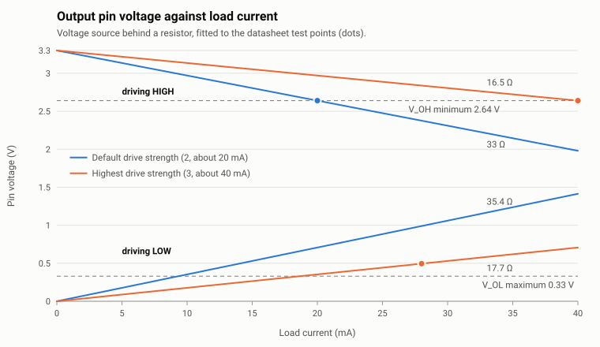
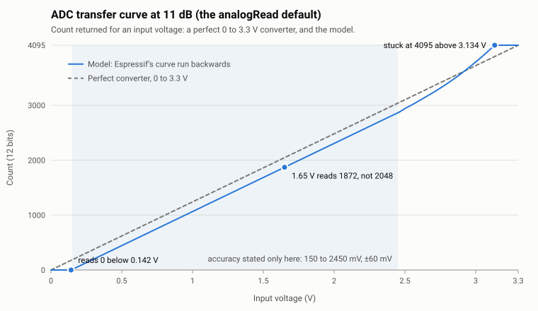
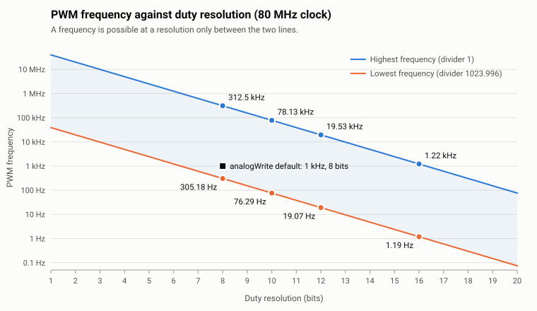
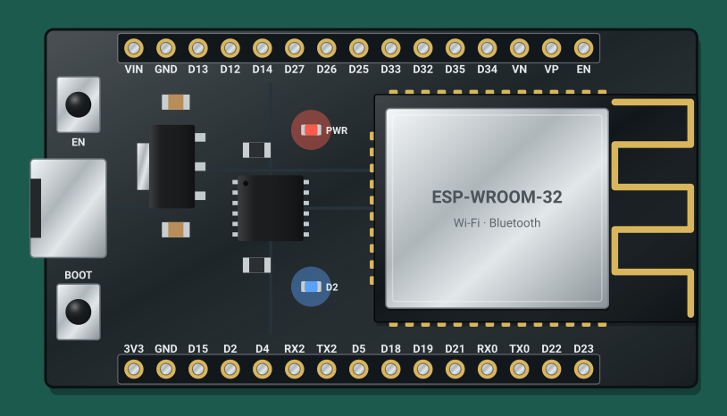

# ESP32 development board: electrical pin model and drawing

Written 22 November 2026. This is the engineering record behind
`packages/simulation/src/esp32-pins.ts` and `apps/web/src/lab/esp32/`.

The board is the 30-pin "ESP-32S" NodeMCU-style ESP32 development board carrying
an ESP-WROOM-32 module. It is the default board of the planned projects and the
school kit.

**What this is and is not.** It is a pin model and a drawing, with tests. It is
not yet used by the editor, the saved-circuit format or the simulation, and it
does not decide how ESP32 programs will be run. **Nothing here has been checked
on real hardware.** No board was measured and no pin was probed.

## How to read the labels

Every number carries one of three labels.

| Label        | Meaning                                                                                       |
| ------------ | --------------------------------------------------------------------------------------------- |
| **VERIFIED** | Read from the named primary document on 22 November 2026. The table or section is given.      |
| **REPORTED** | Widely published, but no primary document was found for it. Treat as likely, not certain.     |
| **ESTIMATE** | Our own calculation or modelling choice, built on the numbers above. The arithmetic is shown. |

VERIFIED means "the document says so". It does not mean a real board was seen
to behave that way.

## Sources

All were fetched and read on 22 November 2026.

| Short name | Document                                                                                                                                                                                                                                    |
| ---------- | ------------------------------------------------------------------------------------------------------------------------------------------------------------------------------------------------------------------------------------------- |
| [DS]       | Espressif, _ESP32 Series Datasheet_, version 5.3 (2026.07). <https://documentation.espressif.com/esp32_datasheet_en.pdf>                                                                                                                    |
| [MOD]      | Espressif, _ESP32-WROOM-32 Datasheet_, version 3.8 (2026-09-16). <https://documentation.espressif.com/esp32-wroom-32_datasheet_en.pdf>. Espressif marks this module "not recommended for new designs"; it is still what these boards carry. |
| [TRM]      | Espressif, _ESP32 Technical Reference Manual_, version 5.9. <https://documentation.espressif.com/esp32_technical_reference_manual_en.pdf>                                                                                                   |
| [IDF]      | Espressif, ESP-IDF, tag `v6.1.1` (released 2026-11-16), source and documentation. <https://github.com/espressif/esp-idf/tree/v6.1.1>                                                                                                        |
| [CORE]     | Espressif, Arduino core for ESP32, tag `4.0.0` (released 2026-11-19), source and documentation. <https://github.com/espressif/arduino-esp32/tree/4.0.0>                                                                                     |
| [REG]      | Advanced Monolithic Systems, _AMS1117 1A Low Dropout Voltage Regulator_ (PDF dated 2009-08-27). <http://www.advanced-monolithic.com/pdf/ds1117.pdf>                                                                                         |

Files used inside [IDF]: `components/esp_adc/esp32/adc_cali_line_fitting.c`,
`components/soc/esp32/include/soc/soc_caps.h`,
`components/esp_driver_ledc/src/ledc.c`, and under
`docs/en/api-reference/peripherals/`: `ledc.rst`, `dac.rst`, `gpio/esp32.inc`,
`adc/adc_calibration.rst`, `adc/adc_oneshot.rst`.

Files used inside [CORE]: `cores/esp32/esp32-hal-adc.c`,
`cores/esp32/esp32-hal-ledc.c`, `cores/esp32/HardwareSerial.h`,
`variants/doitESP32devkitV1/pins_arduino.h`, `docs/en/api/adc.rst`,
`docs/en/api/ledc.rst`.

**What has no primary source.** No document from the maker of the board itself
was found: not a schematic, not a dimensioned drawing. So the order of the pins
along the headers, the parts on the board (regulator, diode, USB-to-serial chip,
LEDs) and the board's size are REPORTED or ESTIMATE throughout. The chip and
module facts are VERIFIED.

## 1. Digital output

### What the datasheet gives

[DS] Table 5-3, "DC Characteristics (3.3 V, 25 °C)". [MOD] Table 14 repeats it.

| Quantity                        | Value                      | Condition in the table                                 | Label    |
| ------------------------------- | -------------------------- | ------------------------------------------------------ | -------- |
| V_OH, high-level output voltage | min 0.8 × VDD = **2.64 V** |                                                        | VERIFIED |
| V_OL, low-level output voltage  | max 0.1 × VDD = **0.33 V** |                                                        | VERIFIED |
| I_OH, high-level source current | typ **40 mA**              | VDD = 3.3 V, V_OH ≥ 2.64 V, drive strength at maximum  | VERIFIED |
| I_OL, low-level sink current    | typ **28 mA**              | VDD = 3.3 V, V_OL = 0.495 V, drive strength at maximum | VERIFIED |

The drive strength of each pin has four settings. [DS] Appendix A.1, note 8:
0 is "~5 mA", 1 is "~10 mA", 2 is "~20 mA", 3 is "~40 mA", and "The default
value is 2". The IO_MUX table in the same appendix shows 2 for every pin. So the
**default drive strength is 2, about 20 mA** (VERIFIED). The 40 mA and 28 mA
figures above are for setting 3, which a sketch does not get unless it asks.

The datasheet gives no V_OH or V_OL at a stated current for the default setting.
That is the gap the estimate below fills.

### Equivalent output resistance

Model: a voltage source (3.3 V when HIGH, 0 V when LOW) behind a resistor.

**Driving HIGH.** The pin may drop from 3.3 V to V_OH = 2.64 V, a drop of 0.66 V,
at the setting's current.

- Setting 3: 0.66 V / 40 mA = **16.5 Ω**. Both numbers are from the table, so this
  is one line of arithmetic on VERIFIED figures.
- Setting 2 (default): 0.66 V / 20 mA = **33 Ω**. ESTIMATE: it assumes "~20 mA"
  is meant at the same 2.64 V as the 40 mA figure. The datasheet does not say so.

**Driving LOW.** The table gives 28 mA at 0.495 V for setting 3.

- Setting 3: 0.495 V / 28 mA = **17.7 Ω**.
- Setting 2 (default): the sink current is scaled by the same ratio as the source
  current, 28 mA × 20/40 = 14 mA, so 0.495 V / 14 mA = **35.4 Ω**. ESTIMATE.

| Drive strength | Source resistance | Sink resistance | Label                             |
| -------------- | ----------------- | --------------- | --------------------------------- |
| 0 (~5 mA)      | 132 Ω             | 141 Ω           | ESTIMATE                          |
| 1 (~10 mA)     | 66 Ω              | 70.7 Ω          | ESTIMATE                          |
| **2, default** | **33 Ω**          | **35.4 Ω**      | ESTIMATE                          |
| 3 (~40 mA)     | 16.5 Ω            | 17.7 Ω          | Arithmetic on the VERIFIED points |



The dots are the datasheet's test points; the lines are the model.

**Worked example.** A red LED (1.8 V at 20 mA in the lab's library) with a 220 Ω
resistor on a pin at the default strength: I = (3.3 − 1.8) / (220 + 33) = 5.93 mA,
and the pin sits at 3.3 − 33 × 0.00593 = 3.10 V.

**What the model gets wrong.** A real output is a transistor, not a resistor. Its
resistance rises as it leaves the linear region, so a shorted pin passes less
than the model's 3.3 V / 33 Ω = 100 mA. The model is fitted at one point per
level and should be trusted for loads up to the setting's current, not beyond.

### Current limits

| Limit                                           | Value                                     | Source                                                                                          | Label               |
| ----------------------------------------------- | ----------------------------------------- | ----------------------------------------------------------------------------------------------- | ------------------- |
| Current at which a default pin still meets V_OH | about 20 mA                               | [DS] Appendix A.1, note 8                                                                       | VERIFIED            |
| Largest current the datasheet characterises     | 40 mA per pin                             | [DS] Table 5-3                                                                                  | VERIFIED            |
| The same with many pins sourcing at once        | falls "from around 40 mA to around 29 mA" | [DS] Table 5-3, note 2                                                                          | VERIFIED            |
| All pins together, chip                         | 1200 mA absolute maximum                  | [DS] Table 5-1, "Cumulative IO output current"                                                  | VERIFIED            |
| All pins together, module                       | 1100 mA absolute maximum                  | [MOD] Table 12                                                                                  | VERIFIED            |
| Per-pin limit used by the model                 | 40 mA                                     | The datasheet states **no** per-pin absolute maximum; 40 mA is the largest current it describes | ESTIMATE as a limit |

The cumulative limit is not what stops a student. The board's regulator and the
USB port run out long before 1.1 A (section 7).

## 2. Digital input

[DS] Table 5-3.

| Quantity                         | As a fraction       | At VDD = 3.3 V                 | Label                                  |
| -------------------------------- | ------------------- | ------------------------------ | -------------------------------------- |
| V_IH, reads HIGH at or above     | 0.75 × VDD          | **2.475 V**                    | VERIFIED                               |
| V_IL, reads LOW at or below      | 0.25 × VDD          | **0.825 V**                    | VERIFIED                               |
| Highest allowed input            | VDD + 0.3 V         | **3.6 V**. Not 5 V tolerant.   | VERIFIED                               |
| Lowest allowed input             | −0.3 V              |                                | VERIFIED                               |
| Input leakage, I_IH and I_IL     | max 50 nA           | at least 3.3 V / 50 nA = 66 MΩ | VERIFIED; the resistance is arithmetic |
| Pin capacitance, C_IN            | typ 2 pF            |                                | VERIFIED                               |
| Pull-up resistance, R_PU         | typ **45 kΩ**       |                                | VERIFIED                               |
| Pull-down resistance, R_PD       | typ **45 kΩ**       |                                | VERIFIED                               |
| EN pin: chip held in reset below | V_IL_nRST max 0.6 V |                                | VERIFIED                               |

A cross-check inside the datasheet: Appendix A.1, note 8 separately gives the
pull strength as "~75 µA". 3.3 V / 45 kΩ = 73 µA. The two agree.

**Hysteresis is not specified.** Table 5-3 gives the two thresholds and nothing
about the band between them. The model therefore does this (ESTIMATE, a
modelling choice): at or above 2.475 V the input reads HIGH, at or below 0.825 V
it reads LOW, and in between it keeps the level it read last. That is the same
rule the lab already uses for the UNO-compatible board's pins. A real pin
switches at some single voltage inside the band, which differs from chip to
chip; the model's 1.65 V of "memory" is wider than any real hysteresis and
should be read as "undefined", not as a promise.

**Pins with no pull resistors, and input-only pins.** GPIO34 to GPIO39 are input
only and have no pull-up or pull-down (VERIFIED: [DS] section 2.3.1; [IDF] GPIO
guide, "GPIO34-39 can only be set as input mode and do not have software-enabled
pullup or pulldown functions"). On this board those are **D34, D35, VP (GPIO36)
and VN (GPIO39)**. GPIO37 and GPIO38 are not brought out by the module.

## 3. The 30 pins

Looking down on the board with the antenna away from you and the USB socket
nearest you: L1 to L15 run down the left side from the antenna end, R1 to R15
down the right side.

- **The order of the pins along the headers is REPORTED.** It is the layout
  published everywhere for 30-pin boards of this style. No document from the
  board's maker was found. **Compare it with the board in the kit before relying
  on it.**
- **The printed labels are REPORTED.** Clones print `D23`, `G23`, `IO23` or
  `23` for the same pin.
- **What each GPIO can do is VERIFIED** from [DS] Table 2-1 (functions), Table
  3-1 (strapping pins and their default pulls), Table 4-6 (ADC, DAC and touch
  channels), the IO_MUX table (state after reset) and [MOD] Table 2.
- **Default roles are VERIFIED** for the Arduino board definition "DOIT ESP32
  DEVKIT V1": [CORE] `variants/doitESP32devkitV1/pins_arduino.h` (SDA 21, SCL 22,
  MOSI 23, MISO 19, SCK 18, SS 5, TX 1, RX 3, `LED_BUILTIN` 2).

Classes: **safe** is an ordinary input or output. **caution** is usable, but its
level at power-up matters or something on the board shares it. **input-only**
cannot drive anything. **avoid** is taken by the USB serial link. **power** is a
supply or ground pin.

| #   | Label | GPIO | Analog in | Other                 | Default role | At reset             | Class      | Why                                                                                                 |
| --- | ----- | ---- | --------- | --------------------- | ------------ | -------------------- | ---------- | --------------------------------------------------------------------------------------------------- |
| L1  | EN    | —    | —         | EN button             | —            | —                    | caution    | Reset. Pulling it below 0.6 V stops the chip; the EN button does that.                              |
| L2  | VP    | 36   | ADC1 ch 0 | —                     | —            | —                    | input-only | Input only: it cannot drive anything and has no pull-up or pull-down.                               |
| L3  | VN    | 39   | ADC1 ch 3 | —                     | —            | —                    | input-only | Input only: it cannot drive anything and has no pull-up or pull-down.                               |
| L4  | D34   | 34   | ADC1 ch 6 | —                     | —            | —                    | input-only | Input only: it cannot drive anything and has no pull-up or pull-down.                               |
| L5  | D35   | 35   | ADC1 ch 7 | —                     | —            | —                    | input-only | Input only: it cannot drive anything and has no pull-up or pull-down.                               |
| L6  | D32   | 32   | ADC1 ch 4 | touch 9               | —            | —                    | safe       | Ordinary pin. Analog input works with Wi-Fi on (ADC1).                                              |
| L7  | D33   | 33   | ADC1 ch 5 | touch 8               | —            | —                    | safe       | Ordinary pin. Analog input works with Wi-Fi on (ADC1).                                              |
| L8  | D25   | 25   | ADC2 ch 8 | DAC1                  | —            | —                    | safe       | Ordinary pin, and analog output 1. Its analog input (ADC2) cannot be read while Wi-Fi is on.        |
| L9  | D26   | 26   | ADC2 ch 9 | DAC2                  | —            | —                    | safe       | Ordinary pin, and analog output 2. Its analog input (ADC2) cannot be read while Wi-Fi is on.        |
| L10 | D27   | 27   | ADC2 ch 7 | touch 7               | —            | —                    | safe       | Ordinary pin. Its analog input (ADC2) cannot be read while Wi-Fi is on.                             |
| L11 | D14   | 14   | ADC2 ch 6 | touch 6               | —            | pull-up              | safe       | Ordinary pin, pulled up after reset. Its analog input (ADC2) cannot be read while Wi-Fi is on.      |
| L12 | D12   | 12   | ADC2 ch 5 | touch 5               | —            | strapping, pull-down | caution    | Read at reset to choose the flash supply voltage: if it is held HIGH then, the board may not start. |
| L13 | D13   | 13   | ADC2 ch 4 | touch 4               | —            | pull-down            | safe       | Ordinary pin, pulled down after reset. Its analog input (ADC2) cannot be read while Wi-Fi is on.    |
| L14 | GND   | —    | —         | —                     | —            | —                    | power      | Ground.                                                                                             |
| L15 | VIN   | —    | —         | —                     | —            | —                    | power      | Supply in, or about 4.65 V out when the board is powered from USB. Not a 3.3 V pin.                 |
| R1  | D23   | 23   | —         | —                     | SPI MOSI     | —                    | safe       | Ordinary pin. SPI data out by default.                                                              |
| R2  | D22   | 22   | —         | —                     | I2C SCL      | —                    | safe       | Ordinary pin. I2C clock by default.                                                                 |
| R3  | TX0   | 1    | —         | USB serial            | UART0 TX     | pull-up              | avoid      | Serial out to the USB link: used to upload programs and by Serial.                                  |
| R4  | RX0   | 3    | —         | USB serial            | UART0 RX     | pull-up              | avoid      | Serial in from the USB link: used to upload programs and by Serial.                                 |
| R5  | D21   | 21   | —         | —                     | I2C SDA      | —                    | safe       | Ordinary pin. I2C data by default.                                                                  |
| R6  | D19   | 19   | —         | —                     | SPI MISO     | —                    | safe       | Ordinary pin. SPI data in by default.                                                               |
| R7  | D18   | 18   | —         | —                     | SPI SCK      | —                    | safe       | Ordinary pin. SPI clock by default.                                                                 |
| R8  | D5    | 5    | —         | —                     | SPI SS       | strapping, pull-up   | caution    | Read at reset and pulled up then, so it is HIGH until the program starts.                           |
| R9  | TX2   | 17   | —         | —                     | UART2 TX     | —                    | safe       | Ordinary pin. The chip routes the third serial port out here.                                       |
| R10 | RX2   | 16   | —         | —                     | UART2 RX     | —                    | safe       | Ordinary pin. The chip routes the third serial port in here.                                        |
| R11 | D4    | 4    | ADC2 ch 0 | touch 0               | —            | pull-down            | safe       | Ordinary pin, pulled down after reset. Its analog input (ADC2) cannot be read while Wi-Fi is on.    |
| R12 | D2    | 2    | ADC2 ch 2 | touch 2, on-board LED | —            | strapping, pull-down | caution    | Read at reset: it must not be held HIGH while a program is uploaded. Drives the on-board LED.       |
| R13 | D15   | 15   | ADC2 ch 3 | touch 3               | —            | strapping, pull-up   | caution    | Read at reset: held LOW then, it silences the start-up messages. Pulled up after reset.             |
| R14 | GND   | —    | —         | —                     | —            | —                    | power      | Ground.                                                                                             |
| R15 | 3V3   | —    | —         | —                     | —            | —                    | power      | The 3.3 V rail from the regulator. Never connect 5 V here.                                          |

Totals: 15 safe, 5 caution, 4 input-only, 2 avoid, 4 power. 25 different GPIOs.

Notes on the table:

- **Strapping pins** (VERIFIED, [DS] section 3). GPIO0 and GPIO2 choose the boot
  mode: download mode needs both LOW (Table 3-3). GPIO12 (MTDI) chooses the flash
  supply: HIGH at reset selects 1.8 V (section 3.2), and this module's flash needs
  3.3 V. GPIO15 (MTDO) LOW at reset turns off the start-up messages (Table 3-4).
  GPIO5 and GPIO15 set SDIO timing, which does not matter here.
- **Not on the headers.** GPIO0 is the BOOT button only (REPORTED for the
  button). GPIO6 to GPIO11 are wired to the flash chip inside the module
  (VERIFIED, [MOD] Table 2, note 2).
- **On-board LED on GPIO2.** VERIFIED for the Arduino board definition
  (`LED_BUILTIN = 2`); REPORTED for any particular clone. Some 30-pin boards
  have only a power light.
- **TX2 and RX2: the label and the Arduino default disagree.** The chip's own
  third serial port is on GPIO17 and GPIO16 (VERIFIED, [DS] IO_MUX table: U2TXD,
  U2RXD), which is why the board prints TX2 and RX2 there. But in [CORE] 4.0.0,
  `Serial2.begin(baud)` with no pins uses **RX 4, TX 25** on an ESP32
  (`HardwareSerial.h`, `RX2`/`TX2`), and this board definition does not override
  them. A lesson that uses Serial2 must pass the pins explicitly:
  `Serial2.begin(9600, SERIAL_8N1, 16, 17)`.
- **Class is a teaching judgement** (ESTIMATE), built on the VERIFIED facts in
  the other columns.

## 4. Analog input (ADC)

### What the documents give

| Fact                                                                    | Source                                                      | Label    |
| ----------------------------------------------------------------------- | ----------------------------------------------------------- | -------- |
| Two 12-bit converters, 18 channels (15 reach this board's headers)      | [DS] section 4.9.1                                          | VERIFIED |
| `analogRead` default: 12 bits, 11 dB attenuation                        | [CORE] `esp32-hal-adc.c` (`__analogAttenuation = ADC_11db`) | VERIFIED |
| Reference is 1100 mV by design, 1000 to 1200 mV between chips           | [IDF] ADC calibration guide                                 | VERIFIED |
| Differential non-linearity ±7 counts, integral ±12 counts               | [DS] Table 4-3 (Wi-Fi off, 100 nF on the pin)               | VERIFIED |
| "±6% differences in measured results between chips" without calibration | [DS] section 4.9.1                                          | VERIFIED |
| Above count 3000 at 11 dB ("approx. 2450 mV") accuracy is worse         | [DS] Table 4-3, note                                        | VERIFIED |
| ADC2 cannot be read while Wi-Fi is on                                   | [IDF] GPIO guide for ESP32; ADC oneshot guide               | VERIFIED |

The attenuation settings, and the input range over which Espressif states an
accuracy after calibration ([DS] Table 4-4, VERIFIED):

| Attenuation (sketch name) | Stated range   | Stated error | Model reads 0 below | Model reads 4095 above |
| ------------------------- | -------------- | ------------ | ------------------- | ---------------------- |
| 0 dB (`ADC_0db`)          | 100 to 950 mV  | ±23 mV       | 75 mV               | 1039 mV                |
| 2.5 dB (`ADC_2_5db`)      | 100 to 1250 mV | ±30 mV       | 78 mV               | 1357 mV                |
| 6 dB (`ADC_6db`)          | 150 to 1750 mV | ±40 mV       | 107 mV              | 1877 mV                |
| 11 dB (`ADC_11db`)        | 150 to 2450 mV | ±60 mV       | 142 mV              | 3134 mV                |

The last two columns are the model's (ESTIMATE, below), for ADC1. ADC2 differs
slightly: 128 mV and 3122 mV at 11 dB.

**Where the sources disagree.**

- The top of the 11 dB range. [DS] Table 4-4 says 2450 mV. [CORE]
  `docs/en/api/adc.rst` says "150 mV ~ 3100 mV". They describe different things:
  the datasheet's is where ±60 mV holds, the Arduino documentation's is roughly
  where the converter stops responding. The model agrees with both: straight to
  about 2.46 V, bent from there to 3.13 V.
- The name of the highest attenuation. The Arduino core calls it `ADC_11db`; ESP-IDF
  6.1.1 calls the same setting `ADC_ATTEN_DB_12`. It is one setting.

### The model

Espressif does not publish a curve from voltage to count. It publishes the
opposite: the calibration code that turns a count into millivolts. For a chip
with no calibration values of its own, that code uses a straight line per
attenuation and, at 11 dB above count 2880, a correction table. Both are in
[IDF] `adc_cali_line_fitting.c` (VERIFIED, copied from it; ESP-IDF is
Apache-2.0).

**The line.** For a reference of 1100 mV:

```
slope  = floor(1100 × scale / 4096)            (integer)
mV     = floor((slope × count + 32768) / 65536) + offset
```

| Attenuation | `scale` (ADC1) | `offset` (ADC1) | slope | mV per count |
| ----------- | -------------- | --------------- | ----- | ------------ |
| 0 dB        | 57431          | 75 mV           | 15423 | 0.23534      |
| 2.5 dB      | 76236          | 78 mV           | 20473 | 0.31239      |
| 6 dB        | 105481         | 107 mV          | 28327 | 0.43224      |
| 11 dB       | 196602         | 142 mV          | 52798 | 0.80563      |

Worked at 11 dB: slope = floor(1100 × 196602 / 4096) = floor(52798.4) = 52798. For
count 1872: floor((52798 × 1872 + 32768) / 65536) = floor(1508.6) = 1508, plus
142, is **1650 mV**.

**The table, 11 dB only.** From count 2880 upward the code interpolates a
20-point table (counts 2880, 2944 … 4096) between a row for a 1000 mV reference
and a row for a 1200 mV one, and blends from the line into the table over the
first step. At the 1100 mV design reference the result is:

| Count | 2880 | 2944 | 3008 | 3072 | 3200 | 3328 | 3456 | 3584 | 3712 | 3840 | 3968 | 4032 | 4095 |
| ----- | ---- | ---- | ---- | ---- | ---- | ---- | ---- | ---- | ---- | ---- | ---- | ---- | ---- |
| mV    | 2462 | 2502 | 2549 | 2593 | 2678 | 2759 | 2833 | 2901 | 2964 | 3024 | 3080 | 3107 | 3134 |

**Running it backwards** (ESTIMATE). The model takes that curve as the
behaviour of a nominal chip and inverts it: for an input voltage, the count is
the one whose voltage on the curve is nearest. In the straight part this has a
closed form a reader can use by hand, at 11 dB:

```
count = 0                               for V ≤ 142 mV
count = round((V_mV − 142) / 0.80563)   for 142 mV < V ≤ 2462 mV   (count 0 to 2880)
count = from the table above, interpolated, for 2462 mV < V < 3134 mV
count = 4095                            for V ≥ 3134 mV
```

Three consequences, all visible in the chart:

1. **Dead zone near 0 V.** Any input below 142 mV reads 0.
2. **An offset, not a gain error.** In the straight part the slope is
   1 / 0.80563 = 1.2413 counts per millivolt, almost exactly a perfect 0 to
   3.3 V converter's 4095 / 3300 = 1.2409. But the line starts at 142 mV, not at
   0 V, so every reading is about 176 counts low (142 × 1.2413).
3. **Compression at the top.** Above about 2.46 V the count rises faster than
   the line and hits 4095 at 3.134 V. The last 166 mV below 3.3 V cannot be told
   apart.



| Input (V) | Perfect converter | Model count | `analogReadMilliVolts` | `count × 3.3 / 4095` (V) | Error of that formula |
| --------- | ----------------- | ----------- | ---------------------- | ------------------------ | --------------------- |
| 0.000     | 0                 | 0           | 142                    | 0.000                    | —                     |
| 0.100     | 124               | 0           | 142                    | 0.000                    | −100 %                |
| 0.150     | 186               | 10          | 150                    | 0.008                    | −94.6 %               |
| 0.500     | 620               | 444         | 500                    | 0.358                    | −28.4 %               |
| 1.000     | 1241              | 1065        | 1000                   | 0.858                    | −14.2 %               |
| 1.650     | 2048              | 1872        | 1650                   | 1.509                    | −8.6 %                |
| 2.000     | 2482              | 2306        | 2000                   | 1.858                    | −7.1 %                |
| 2.450     | 3040              | 2865        | 2450                   | 2.309                    | −5.8 %                |
| 2.500     | 3102              | 2941        | 2500                   | 2.370                    | −5.2 %                |
| 3.000     | 3723              | 3790        | 3000                   | 3.054                    | +1.8 %                |
| 3.100     | 3847              | 4015        | 3100                   | 3.236                    | +4.4 %                |
| 3.200     | 3971              | 4095        | 3134                   | 3.300                    | +3.1 %                |
| 3.300     | 4095              | 4095        | 3134                   | 3.300                    | 0 %                   |

The fifth column is the conversion found in most beginner sketches. The table is
the reason a lesson should use `analogReadMilliVolts`, and the reason a grounded
pin "reads 142 mV" there.

### Error of the model

- **Against its source.** The model is the source curve inverted, so the two
  agree by construction: feeding the model's count back through Espressif's
  arithmetic returns the input to within 1 mV everywhere between the dead zone
  and the saturation point, at all four attenuations. A unit test checks this
  every 0.5 mV.
- **The port itself.** The TypeScript arithmetic was written by reading the C
  code and checked by hand at the points in the tests. It has **not** been run
  side by side with the C code.
- **Against a real chip.** Not measured. What Espressif states: after
  calibration, ±60 mV between 150 and 2450 mV at 11 dB ([DS] Table 4-4), and
  worse above that. Without calibration, ±6 % between chips. Most chips carry a
  factory reference value and use it in place of the 1100 mV default, so a real
  board's counts differ from the model's by up to about ±9 % (1000 to 1200 mV
  against 1100 mV) while its `analogReadMilliVolts` stays within the stated error.
- **Not modelled.** Noise, the effect of source impedance, the non-linearity
  inside the straight part (±12 counts), and temperature.

### Resolution

`analogReadResolution(bits)` ([CORE] `esp32-hal-adc.c`, VERIFIED): on an ESP32,
9 to 12 bits set the converter's own width; any other value from 1 to 16 is
shifted from the nearest width it has. The model takes a narrower width to be
the 12-bit result with its low bits dropped (ESTIMATE). So 1.65 V reads 1872 at
12 bits, 468 at 10, 117 at 8 and 29952 at 16.

### ADC2 and Wi-Fi

The second converter is shared with the radio. While Wi-Fi is on, a read of an
ADC2 pin fails (VERIFIED, [IDF] GPIO guide: "ADC2 pins cannot be used when Wi-Fi
is used"). On this board that is D4, D2, D15, D13, D12, D14, D27, D25 and D26.
A lesson that uses Wi-Fi must put its analog sensors on **D32, D33, D34, D35, VP
or VN**.

## 5. PWM (LEDC)

[TRM] section 28.2.2 (VERIFIED). A PWM timer divides its clock by a divider and
then counts 2^N steps, N being the duty resolution in bits:

```
f_PWM = f_clock / (divider × 2^N)
```

The divider is a fixed-point number with 10 whole bits and 8 fractional bits, so
it runs from 1 to 1023 + 255/256. The clock is the 80 MHz APB clock unless
another is chosen (8 MHz and 1 MHz sources also exist). So:

```
highest frequency at N bits = 80 MHz / 2^N            (divider 1)
lowest frequency at N bits  = 80 MHz / (1023.996 × 2^N)
```

| Resolution | Duty steps | Highest frequency | Lowest frequency (80 MHz clock) |
| ---------- | ---------- | ----------------- | ------------------------------- |
| 8 bits     | 256        | **312.5 kHz**     | 305.18 Hz                       |
| 10 bits    | 1024       | **78.125 kHz**    | 76.29 Hz                        |
| 12 bits    | 4096       | **19.531 kHz**    | 19.07 Hz                        |
| 16 bits    | 65536      | **1.2207 kHz**    | 1.192 Hz                        |

Arithmetic: 80 000 000 / 256 = 312 500; / 1024 = 78 125; / 4096 = 19 531.25;
/ 65 536 = 1 220.70. The lowest is each of those divided by 1023.996.



**Check against the manual.** [TRM] Table 28.2-1 lists, for a frequency and a
clock, the highest and lowest resolution. The same formula reproduces all six
rows (1 kHz: 16 and 7 bits; 5 kHz: 13 and 4; 10 kHz: 12 and 3; at 8 MHz, 1 kHz:
12 and 3, 2 kHz: 11 and 2; at 1 MHz, 1 kHz: 9 and 1), and a unit test holds it
there.

**`analogWrite` default: 1000 Hz at 8 bits** (VERIFIED, [CORE]
`esp32-hal-ledc.c`: `analog_frequency = 1000`, `analog_resolution = 8`). It sits
between the 8-bit limits above (and between those of the 1 MHz clock: 3.8 Hz to
3.9 kHz). `analogWrite(pin, 255)` is fully on.

Details worth knowing:

- **Lower frequencies need more bits or another clock.** A 50 Hz servo signal
  cannot be made at 8 bits from the 80 MHz clock (the lowest is 305 Hz); it needs
  at least 11 bits, or the 1 MHz clock.
- **Which clock is used is the driver's choice.** The Arduino core asks for
  automatic selection, and [IDF] `ledc.c` then tries a timer's own slower clock
  before the 80 MHz one. The table above is for 80 MHz, which sets the highest
  frequency that can be reached at all. Which clock the driver ends up with for
  a given request was not traced, and it does not change the frequency or the
  resolution a sketch gets.
- **The driver rounds.** [IDF] `ledc.c` rounds the divider to the nearest
  1/256, so it accepts a request up to 0.2 % above the "highest" column and
  then produces exactly that column's frequency.
- **A disagreement on the maximum resolution.** [TRM] and [IDF] `soc_caps.h`
  give a 20-bit counter; [DS] Table 4-6 says "Duty accuracy: 16 bits". The model
  allows 20.

## 6. Analog output (DAC)

| Fact                                       | Source             | Label    |
| ------------------------------------------ | ------------------ | -------- |
| Two channels, 8 bits                       | [DS] section 4.9.2 | VERIFIED |
| Channel 1 on GPIO25, channel 2 on GPIO26   | [DS] Table 4-6     | VERIFIED |
| Output = VDD × value / 255                 | [IDF] DAC guide    | VERIFIED |
| Built from "resistor strings and a buffer" | [DS] section 4.9.2 | VERIFIED |

At 3.3 V one step is 3.3 / 255 = 12.94 mV; `dacWrite(25, 128)` asks for 1.656 V.
The reference is the supply, so the output moves with the 3.3 V rail.

**Output impedance: not specified.** Neither [DS] nor [TRM] gives the DAC's
output impedance, its load limit or its settling time. The model therefore
provides only the unloaded voltage. Before the DAC drives anything in a
simulated circuit, a value must be measured or the output marked "unloaded
only".

## 7. Power

### The regulator

An AMS1117-3.3 is **typical** of these boards (REPORTED), not certain: clones
fit other regulators with other limits. The figures below are VERIFIED from
[REG].

| Quantity                     | Value                                               |
| ---------------------------- | --------------------------------------------------- |
| Output voltage, AMS1117-3.3  | 3.300 V; 3.201 to 3.399 V over temperature          |
| Dropout (input minus output) | typ 1.1 V, max 1.3 V at 0.8 A; less at lighter load |
| Rated output current         | the dropout is specified up to 0.8 A                |
| Current limit                | min 900 mA, typ 1100 mA                             |
| Quiescent current            | typ 5 mA, max 11 mA                                 |
| Maximum input voltage        | 15 V                                                |
| Thermal resistance, SOT-223  | 90 °C/W; 46 °C/W or better with copper beneath it   |
| Maximum junction temperature | 125 °C                                              |

### VIN when powered from USB

REPORTED: these boards put a diode between the USB socket's 5 V and the VIN pin,
so that an external supply on VIN cannot feed back into the computer. The part
varies by clone; a small Schottky diode is usual.

ESTIMATE: USB 5.0 V (nominal; the USB specification was not consulted) minus a
Schottky drop of about 0.35 V at 0.1 to 0.5 A gives **VIN ≈ 4.65 V**. That
leaves 4.65 − 3.3 = 1.35 V across the regulator, just above its 1.3 V worst-case
dropout at 0.8 A. With a tired USB port at 4.75 V and a diode dropping 0.45 V it
is 1.0 V, below the typical dropout at full load. This is consistent with the
REPORTED habit of these boards resetting when the radio transmits on a weak USB
port, but it has not been measured here.

A 5 V sensor wired to VIN on a USB-powered board gets about 4.65 V, not 5 V.

### What the module draws

| Condition                                 | Current                | Source                         | Label    |
| ----------------------------------------- | ---------------------- | ------------------------------ | -------- |
| Wi-Fi off, both cores at 240 MHz          | 30 to 68 mA            | [DS] Table 4-2, Modem-sleep    | VERIFIED |
| Wi-Fi off, 80 MHz                         | 20 to 31 mA            | [DS] Table 4-2                 | VERIFIED |
| Wi-Fi on, listening or receiving          | 95 to 100 mA           | [DS] Table 5-4                 | VERIFIED |
| Transmitting, 802.11n / 802.11g / 802.11b | 180 / 190 / **240 mA** | [DS] Table 5-4, at 50 % duty   | VERIFIED |
| Supply should be able to deliver          | at least 500 mA        | [DS] Table 5-2, [MOD] Table 13 | VERIFIED |

"Connected" is not one number: [DS] notes that with Wi-Fi enabled the chip
switches between the active and modem-sleep rows, so the average lies between
about 30 mA and 100 mA depending on traffic, with bursts to 240 mA.

### What that leaves for sensors

Two limits apply, and the smaller wins.

**The USB port.** REPORTED: a USB 2.0 port supplies 500 mA. ESTIMATE: the rest of
the board (USB-to-serial chip, power light, regulator's own 5 to 11 mA) takes
about 30 mA; that figure is not from a datasheet.

| Chip state         | Chip draws | Left on 3V3 from a 500 mA port |
| ------------------ | ---------- | ------------------------------ |
| Wi-Fi off (worst)  | 68 mA      | 500 − 30 − 68 = **402 mA**     |
| Wi-Fi receiving    | 100 mA     | 500 − 30 − 100 = **370 mA**    |
| Wi-Fi transmitting | 240 mA     | 500 − 30 − 240 = **230 mA**    |

A working rule for lessons (ESTIMATE): **keep everything hung on the 3V3 pin
under 200 mA**, and remember that current sourced by GPIO pins comes out of the
same budget.

**The regulator's heat.** It turns (VIN − 3.3 V) × I into heat. With 90 °C/W and
a 125 °C limit, in a 35 °C room it can shed (125 − 35) / 90 = 1.0 W.

| Supply on VIN | Voltage dropped | Continuous current before overheating |
| ------------- | --------------- | ------------------------------------- |
| USB (4.65 V)  | 1.35 V          | 1.0 / 1.35 = 741 mA                   |
| 7 V           | 3.7 V           | 270 mA                                |
| 9 V battery   | 5.7 V           | **175 mA**                            |
| 12 V adapter  | 8.7 V           | **115 mA**                            |

So from USB the port is the limit, not the regulator. From a 9 V or 12 V supply
on VIN the regulator is the limit, and it is below what the chip draws while
transmitting. A board fed 12 V on VIN with Wi-Fi busy runs its regulator hot
with nothing attached at all. These are ESTIMATES for a regulator with no copper
to cool it; a real board has some, and will do better by an unknown amount.

## 8. The drawing



`apps/web/src/lab/esp32/Esp32BoardView.tsx` draws the board from above, USB
socket on the left, in the style of the lab's other parts: flat colour under the
shared shading gradients, a soft cast shadow. It takes the same three props as
the UNO-compatible board's drawing (`selected`, `powered`, `ledLevel`) and a
`variant`. The file above is a static copy, written by `pnpm esp32:board`; a
unit test fails if it falls out of step with the component.

Turned this way, the board's left row (EN … VIN) runs along the top and its
right row (D23 … 3V3) along the bottom, both with the antenna end on the right.

### Row spacing: two variants, neither measured

The distance between the two rows of pins **differs between clones**. Two values
are commonly quoted (REPORTED): 0.9 inch (22.86 mm) and 1.0 inch (25.4 mm).
`geometry.ts` models both as named variants, each marked `measured: false`, and
draws the 1.0 inch one by default because it is quoted more often for the
30-pin board. **A real board from the kit must be measured** (centre of a pin
in one row to the centre of the pin opposite) before the board is placed on the
lab's breadboard.

What each means on the 830-hole breadboard. Its rows a to e and f to j are one
pitch apart, with three pitches from e to f across the centre channel. A pin in
row b leaves hole a free beside it; the holes on the inner side are under the
board.

| Row spacing           | Possible placements (top row, bottom row) | Free holes beside each top pin | Free holes beside each bottom pin |
| --------------------- | ----------------------------------------- | ------------------------------ | --------------------------------- |
| 0.9 inch (9 pitches)  | a and h                                   | 0                              | 2                                 |
|                       | **b and i**                               | **1**                          | **1**                             |
|                       | c and j                                   | 2                              | 0                                 |
| 1.0 inch (10 pitches) | a and i                                   | 0                              | 1                                 |
|                       | b and j                                   | 1                              | 0                                 |

So a 0.9 inch board leaves one hole free on each side of every pin. A 1.0 inch
board leaves **one hole on one side and none on the other**: half its pins
cannot be wired on a single breadboard. If the kit's board is the 1.0 inch kind,
the lab will need to show it across two breadboards, on a carrier, or beside the
breadboard with wires, as the UNO-compatible board is today. That decision
waits for the measurement.

### What is to scale and what is not

| Part of the drawing                                                                            | Basis                                                                            | Label                |
| ---------------------------------------------------------------------------------------------- | -------------------------------------------------------------------------------- | -------------------- |
| Pin pitch, 2.54 mm = 24 units                                                                  | Standard header pitch                                                            | REPORTED             |
| Row spacing                                                                                    | The two variants above                                                           | REPORTED, unmeasured |
| Module outline, 18 mm × 25.5 mm                                                                | [MOD] Table 1 and Figure 7                                                       | VERIFIED             |
| Shield, 15.8 mm × 17.6 mm                                                                      | Read off [MOD] Figure 7; which dimension belongs to which feature is our reading | ESTIMATE             |
| Module pads, 1.27 mm apart, 14 + 10 + 14                                                       | [MOD] Figure 7 and Table 2                                                       | VERIFIED             |
| Board length 51.5 mm, 1.45 mm from pin row to edge, first pin 7 mm from the USB end            | Typical of published dimensions; no board measured                               | ESTIMATE             |
| Position and size of the USB socket, buttons, regulator, USB-to-serial chip, LEDs, small parts | Placed to look like the board; not from any drawing                              | ESTIMATE             |

Not drawn to scale or not drawn at all:

- **The labels.** They are drawn larger than on a real board so they can be read
  at the lab's normal zoom, and upright; a real board prints them sideways.
- **The header pins.** Seen from above, a soldered header shows only its solder
  joints; the black plastic strip is underneath. The drawing shows the joints in
  a printed outline.
- **The antenna** is a simple folded track, not the module's real pattern.
- **Left out:** mounting holes (some clones have them, some do not), the
  crystal, most resistors and capacitors, and all printed markings other than
  the pin labels and the names of the buttons and lights.
- **Which side the EN and BOOT buttons are on** is REPORTED.

## Regenerating the figures

```bash
pnpm esp32:charts   # the three charts, from the pin model itself
pnpm esp32:board    # the static copy of the board drawing
```

`scripts/esp32-charts.mjs` imports `esp32-pins.ts` directly, so a chart cannot
disagree with the code. Every number in this document that the code also holds
is pinned by a test in `packages/simulation/src/esp32-pins.test.ts` or
`apps/web/src/lab/esp32/geometry.test.ts`.

## To check by hand

1. **Pin order and labels** against the board in the kit (section 3).
2. **Row spacing** of that board, with calipers (section 8).
3. **The regulator, the diode and the USB-to-serial chip** actually fitted.
4. **The on-board LED**: is there one, and is it on GPIO2?
5. On a bench, when the hardware tests begin: the ADC curve at 11 dB (0 V,
   0.15 V, 1.65 V, 2.45 V, 3.0 V, 3.3 V), an output pin's voltage at 5, 10 and
   20 mA, the input thresholds, and VIN under USB power.
6. The ADC arithmetic against Espressif's C code, by running both.
